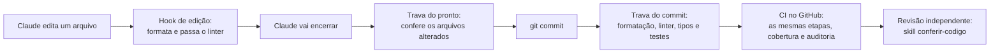

# padroes-de-qualidade

Kit de padrões de código e de segurança para os projetos do Aryel. Ele junta regras escritas, ferramentas que as
conferem sozinhas e provas de que essas ferramentas funcionam.

> Versão **0.9**. **O uso é opcional:** o kit só vale num projeto ou numa sessão quando a pessoa pede (por exemplo,
> "siga o kit padroes-de-qualidade"). Nada aqui se instala nem se aplica sozinho.

## Como o código é conferido



As quatro primeiras conferências são automáticas depois de instaladas. A revisão independente é pedida com
`/conferir-codigo` antes de dizer que a tarefa está pronta. As regras estão no [`PADROES.md`](PADROES.md), seções 4A
(código) e 6 (segurança).

## Instalar

```text
python instalar.py projeto CAMINHO_DO_PROJETO --tipo python     (ou --tipo node)
python instalar.py maquina                                      (uma vez: skill de revisão e estilo Professor)
```

O instalador copia cada modelo para o lugar certo, **não sobrescreve** o que já existe e liga a trava do commit.
Os detalhes, o que fazer depois e como desligar estão em [`docs/INSTALACAO.md`](docs/INSTALACAO.md).

Frase para abrir uma sessão do Claude Code num projeto que usa o kit:

> Siga o kit padroes-de-qualidade: leia o CLAUDE.md e o REGRAS.md do kit. Este projeto é de nível [N], ritmo
> [rápido ou completo]. Antes de escrever código, proponha o desenho e espere minha aprovação.

## O que é provado e o que não é

`python provas/conferir-provas.py` monta projetos de exemplo com o instalador e roda as ferramentas de verdade. Roda no
CI do kit a cada envio, em **Linux e em Windows**. Regra automática nova só entra com prova.

| Provado por execução | Ainda não executado |
| --- | --- |
| Cada regra de linter pega um exemplo ruim e libera o bom (Python, JavaScript e TypeScript) | O Claude Code disparando os hooks a partir do `settings.json` |
| Formatadores, tipos estritos, comando único, trava do commit e os scripts dos hooks | A skill `/conferir-codigo` e o estilo de saída Professor |
| Instalador: arquivos certos, não sobrescreve, projeto recém-instalado passa na conferência | Os plugins e comandos de segurança do Claude Code com os modelos do kit |
| Projeto Python de ponta a ponta: ambiente virtual, `pip install -e ".[dev]"`, etapas do CI modelo e primeiro commit | Os workflows modelo rodando no GitHub de um projeto real (Node, CodeQL e Dependabot) |
| Padrões de segurança, modelos de `.gitignore`, imagem Docker do modelo | |

O que está na coluna da direita só dá para conferir numa sessão real do Claude Code ou num projeto real.

## O que tem aqui

Por que cada arquivo existe e que alternativas havia: [`docs/MAPA-DE-ARQUIVOS.md`](docs/MAPA-DE-ARQUIVOS.md).

| Arquivo | Para que serve |
| --- | --- |
| [`REGRAS.md`](REGRAS.md) | A única leitura de cada sessão que usa o kit: o que abrir em cada momento e as 18 regras que saíram dos erros |
| [`PADROES.md`](PADROES.md) | Documento mestre, lido por seção: níveis, testes, conferência de código, CI/CD, segurança, LGPD, API, front-end |
| [`REVISAO.md`](REVISAO.md) | Perguntas de revisão por momento |
| [`CONTEXTO.md`](CONTEXTO.md) | Quem é a pessoa, como ensinar, mapa dos projetos, glossário e decisões |
| [`ERROS.md`](ERROS.md) e [`PRATICAS.md`](PRATICAS.md) | Catálogo de erros, de consulta, e práticas candidatas |
| [`instalar.py`](instalar.py) | Instala o kit num projeto ou na máquina |
| [`templates/`](templates/) | Os modelos que o instalador copia: configurações, hooks, travas, CI, skill e estilo de saída |
| [`provas/`](provas/) | Exemplos ruins e bons e o script que prova as regras |
| [`docs/REFERENCIAS.md`](docs/REFERENCIAS.md) | De onde vieram as regras: documentação oficial, OWASP e artigos revisados por pares |

## Como o kit evolui

- Erro que ensina vira entrada no `ERROS.md`; se revelar uma regra geral, ela entra no `REGRAS.md` (limite de 80 linhas).
- Regra automática só entra com prova em `provas/`. Práticas novas começam como candidatas no `PRATICAS.md`.
- Um assunto por commit, com mensagem `tipo(kit): o que mudou` (`docs`, `feat`, `fix`, `test`, `refactor` ou `chore`;
  as provas conferem o formato). Mudanças ficam no `CHANGELOG.md`.
- Claude pode acrescentar erros, dificuldades, práticas e termos; mudar a estrutura pede a aprovação da pessoa.
- O repositório é público: nada sensível sobre a pessoa entra aqui (`CONTEXTO.md`).
